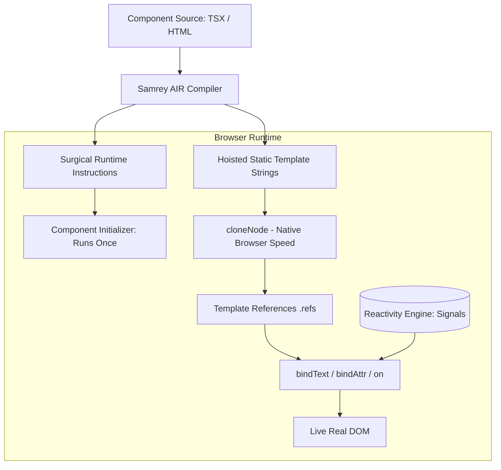

# Samrey Framework — Architecture Specification (ARCHITECTURE.md)

**Version:** 2.1.0  
**Status:** Living Canonical Architecture Specification

---

## 1. System Overview

Samrey splits application execution into two clear phases:
1. **Ahead-of-Time (AOT) Compilation Phase**:
   Source components and JSX/TSX templates are analyzed into an Intermediate Representation (AIR). Static HTML trees are hoisted into reusable `<template>` elements. Reactive access points are identified and compiled into micro-binding instructions.
2. **Runtime Execution Phase**:
   When a component is mounted:
   - It is instantiated **EXACTLY ONCE**.
   - Hoisted templates are cloned via the browser native `Node.cloneNode(true)`.
   - Element references (`refs`) are acquired in $O(1)$ without DOM query overhead.
   - Signal subscriptions connect directly to the target DOM nodes.
   - Subsequent state updates directly mutate the affected DOM nodes without touching the component tree.



---

## 2. Reactivity Engine Architecture (`@samrey/reactivity`)

The reactivity engine implements a **Push-Pull Topological Dependency Graph** with the following properties:
- **Push Phase (Marking Dirty)**: When a signal is written via `signal.value = x`, `signal.set(x)`, or `signal.update(fn)`, it increments the global versioned transaction clock and pushes dirty notifications down the subscriber graph.
- **Pull Phase (Evaluation)**: Computeds and effects lazily pull updated values on demand, ensuring intermediate values in diamond dependency graphs are never evaluated redundantly.
- **Cycle Prevention & Infinite Loop Protection**: A batch cycle limit (default: 10,000 passes) prevents infinite loops. In addition, signal writes take snapshot arrays of subscriber sets before notification dispatch to ensure stable iteration when effects re-subscribe.
- **Ownership & Lifecycle Trees**: The `Owner` hierarchy (`createRoot`, `createOwner`, `runWithOwner`, `onCleanup`) tracks effects and computed dependencies. When an owner is disposed (e.g., when a route unmounts or a `<Show>` branch changes), all child subscriptions are unregistered automatically.

---

## 3. Runtime & DOM Binding Architecture (`@samrey/runtime`)

### Template Cloning & Template References
Samrey does not call `document.createElement()` iteratively for static subtrees. Instead:
```ts
// Hoisted at module scope
const _tmpl = template('<div class="user-card"><h3 ref="name"></h3><span ref="badge"></span></div>');

export function UserCard(props: { name: Signal<string>; role: Signal<string> }) {
  // Clones the pre-parsed browser template
  const root = _tmpl.clone();
  const { name, badge } = root.refs;

  // Direct surgical binding
  bindText(name, () => props.name.value);
  bindText(badge, () => props.role.value);

  return root;
}
```

### Control Flow Mechanics
Unlike frameworks that introduce virtual DOM reconciliation for conditionals and loops, Samrey provides fine-grained control flow as higher-order component functions:
- **`Show({ when, children, fallback })`**: Evaluates `when()`. When the boolean condition flips, it tears down the old owner context, invokes cleanups, and mounts the new branch using comment anchor nodes.
- **`For({ each, key, children })`**: Manages keyed lists of items using fine-grained DOM list reconciliation. Individual rows are created once per unique item key. When items reorder or update, existing DOM nodes are moved or updated without rebuilding the entire list.

---

## 4. Compiler & AIR Architecture (`@samrey/compiler`)

The compiler converts template strings or JSX into executable JavaScript:
1. **Lexing & Parsing**: `TemplateParser` parses template markup into an Abstract Syntax Tree (AST).
2. **Intermediate Representation (AIR)**: `buildAIRFromAST` categorizes nodes into:
   - Static subtrees (eligible for hoisting)
   - Dynamic text bindings
   - Dynamic attribute/class/style bindings
   - Event handlers
   - Template references (`ref="..."`)
3. **Security Classification**: Classifies attributes against dangerous URI protocols (`javascript:`, `vbscript:`, `data:text/html`), unsanitized HTML sinks, and CSS injection vectors.
4. **Code Generation**: Emits static `template("...")` declarations and runtime wiring functions (`bindText`, `bindAttr`, `on`).

---

## 5. Server-Side Rendering & Hydration (`@samrey/ssr`)

- **Asynchronous & Streaming SSR**: `renderToString()` and `renderToStream()` execute components in a Node.js SSR context, generating deterministic, fully-formed HTML.
- **State Serialization**: Reactive state is serialized into an inline `<script>` payload with prototype pollution protection and script-tag injection defenses (`\u003c/script\u003e` escaping).
- **Resumable Event Delegation**: A tiny pre-hydration snippet captures user clicks or keyboard events that occur before client JavaScript finishes downloading, and safely replays them once hydration completes.
- **Surgical Client Hydration**: `hydrate()` attaches reactive signals and event listeners directly to existing server-rendered HTML elements without discarding and recreating the DOM tree.

---

## 6. Security Architecture (`@samrey/security`)

Security in Samrey is baked into the runtime and compiler:
- **Contextual Sanitization**: `sanitizeHtml()`, `sanitizeUrl()`, and `sanitizeCssStyle()` sanitize dynamic inputs before injecting into sensitive sinks.
- **Trusted Types Integration**: Automatic compliance with the W3C Trusted Types API prevents DOM-based cross-site scripting (DOM XSS).
- **Anti-CSRF Protection**: Cryptographically secure, timing-safe anti-CSRF token generator and validator (`generateCsrfToken`, `verifyCsrfToken`).
- **Secret Scrubbing**: SSR serializers automatically redact sensitive keys (`password`, `token`, `secret`, `authorization`, `cookie`, `apiKey`, `creditCard`) to prevent credential leakage to client state payloads.
