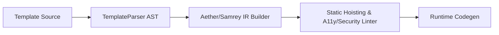

# Samrey Framework — Compiler Rules & AIR Specification (COMPILER_RULES.md)

**Package:** `@samrey/compiler`  
**Version:** 2.1.0  
**Authority:** Mandatory Compiler Rules for AI Agents

---

## 1. Compiler Pipeline Overview

The Samrey compiler is an Ahead-of-Time (AOT) toolchain that translates declarative markup into zero-overhead surgical JavaScript code.



### Key Stages
1. **Parser (`parseTemplate`)**:
   Constructs a typed AST preserving source locations (line, column, character offsets) for precise error reporting.
2. **Intermediate Representation (`buildAIR`)**:
   Categorizes nodes into:
   - Invariant HTML elements (hoisted into `template()` declarations)
   - Dynamic text expressions (compiled to `bindText`)
   - Dynamic attributes and event listeners (compiled to `bindAttr` and `on`)
   - Control flow directives (`Show`, `For`, `Switch`)
3. **Security Classifier (`classifySecurityNode`)**:
   Detects dangerous attributes (`href="javascript:..."`, unescaped raw HTML sinks).
4. **Accessibility Linter (`lintAccessibility`)**:
   Verifies images have `alt` tags, inputs have associated labels, and buttons have accessible names.
5. **Code Generator (`generateCode`)**:
   Emits optimized JavaScript targeting the `@samrey/runtime` engine.

---

## 2. Static Hoisting Rules

- **Pure Static Subtrees**: Any HTML element whose attributes and descendants contain no dynamic expressions `{...}` is hoisted to the top level of the generated module:
  ```ts
  const _tmpl$1 = template('<header class="site-header"><h1>Samrey</h1></header>');
  ```
- **Mixed Subtrees with Template References**: If an element contains dynamic text or event handlers, its invariant HTML structure is preserved and dynamic targets receive `ref="..."` identifiers so the runtime accesses them in $O(1)$ without runtime selectors.

---

## 3. Strict Compiler Validation Rules

The compiler rejects the following anti-patterns at build time:
- **`SAMREY-101`**: Unclosed HTML tag (e.g. `<div><span></div>`).
- **`SAMREY-102`**: Unclosed or malformed interpolation expression `{...`.
- **`SAMREY-104`**: Unexpected closing tag.
- **`SAMREY-107`**: Duplicate attribute on a single tag.
- **`SAMREY-108`**: Using `<Show>` or `<For>` as template tags in HTML.
- **`SAMREY-109`**: Duplicate `ref="id"` within the same template root.
- **`SAMREY-201`**: Security violation (e.g. `javascript:` URI scheme).
- **`SAMREY-202`**: Accessibility violation (e.g. missing `alt` on ``).

---

## 4. Vite Plugin Integration (`@samrey/cli/vite-plugin`)

In standard Samrey projects, compilation is transparently handled via `samreyPlugin()` in `vite.config.ts`:
```ts
import { defineConfig } from 'vite';
import { samreyPlugin } from '@samrey/cli';

export default defineConfig({
  plugins: [samreyPlugin()]
});
```
